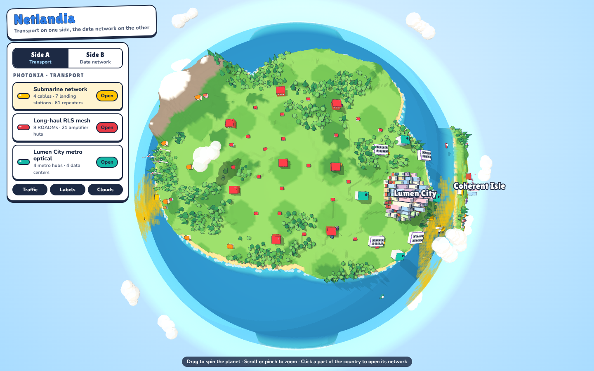
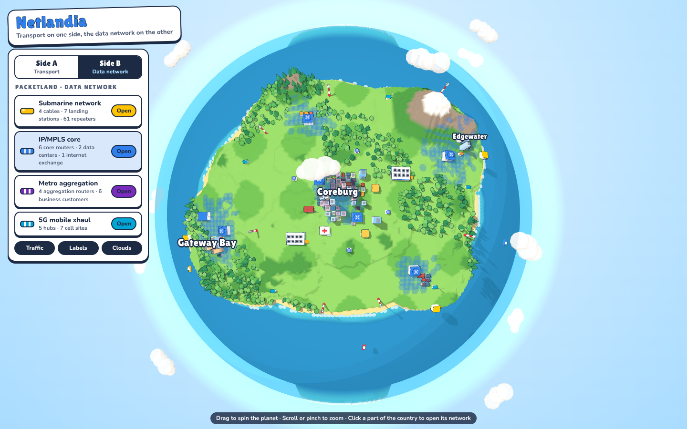
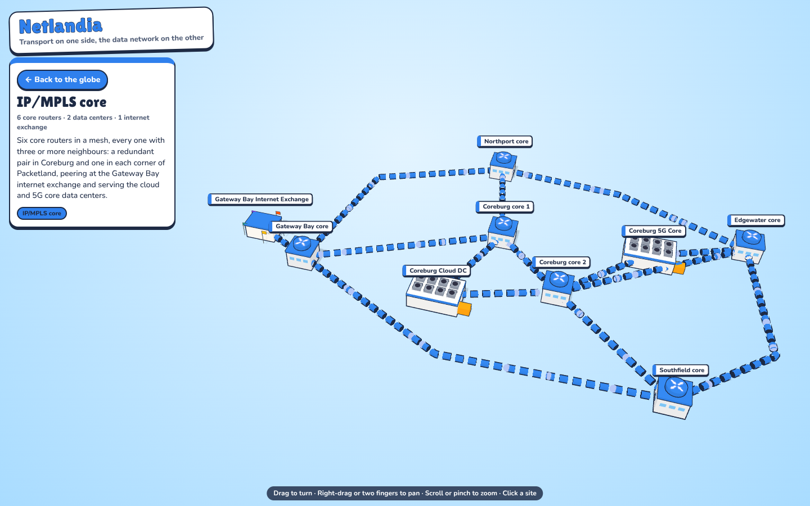
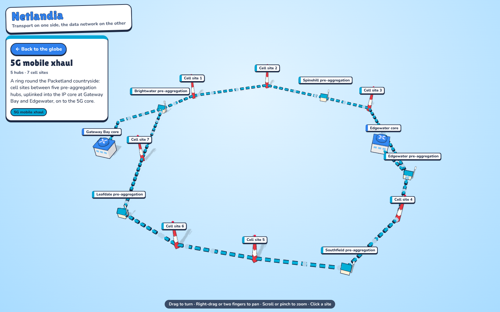
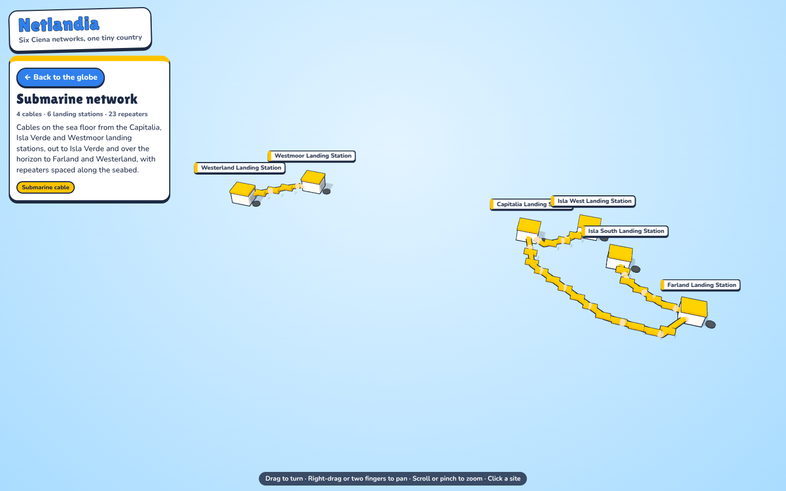
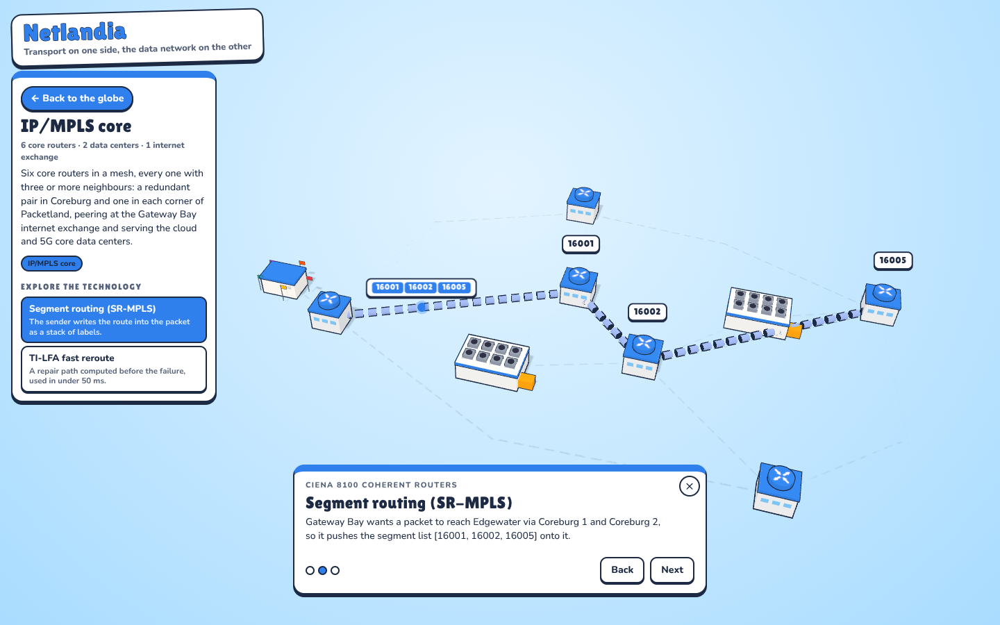
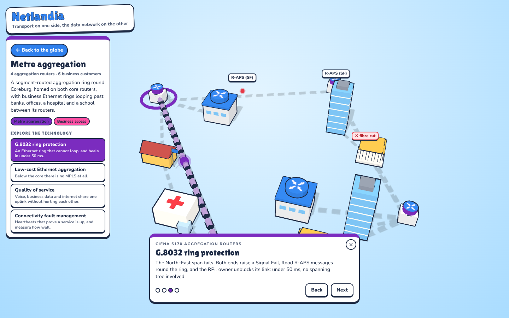

# Ciena Explorer — Netlandia

A cartoon 3D globe called Netlandia, with a country on each face. **Side A**, Photonia, carries the
transport networks. **Side B**, Packetland, carries the data network that rides on
them. Spin the planet all the way round, or flip sides from the panel, then click
one of the six major networks to open it on its own in open space, where every
site can be clicked for its equipment and connections. Packets run along every link.

| Side A: transport | Side B: data network |
|---|---|
|  |  |

## Two ways to read it: Explorer and Engineer

The switch under the title picks how the map is labelled, and the choice is remembered.

| | Explorer | Engineer |
|---|---|---|
| for | an introduction to networking: no acronyms, no part numbers | people who already know the trade |
| look | the board game: sticker cards, rounded type, a daylight sky, whales and an airliner | a flat, dark console: plain type, mono labels, no toys |
| networks | *Countrywide light highway*, *Internet core*, *Mobile phone network*… | *Long-haul RLS mesh*, *IP/MPLS core*, *5G mobile xhaul*… |
| sites | *light junction*, *booster hut*, *collector router*, *beach cable station* | *RLS ROADM site*, *RLS amplifier hut*, *aggregation router*, *cable landing station* |
| site card | what the place does and what is inside, in plain words | its role and the Ciena equipment in it |
| explainers | **Learn how it works**: data travels as light, many colours in one fibre (DWDM, in plain words), what a packet is, finding another way, who goes first, your phone call's journey | **Explore the technology**: CDC ROADMs, mesh restoration, SR-MPLS, TI-LFA, G.8032, QoS, CFM… |

Explorer's words live in `js/vocab.js` and its explainers in `js/basics.js`; a test
checks that nothing Explorer prints uses the trade's acronyms (the DWDM topic, which
is there to introduce one, is the exception). A link to an explainer only one mode
has, such as `#ipcore.sr`, switches to that mode.

## The two sides

The globe is a toy world, not a diagram: nothing is wired up on it. The equipment
stands in the landscape as landmarks (a data center campus, a landing station on
the beach, amplifier huts up the mountain road, cell towers on the hills), and each
network is a **region** of its country. Hover a region and the ground there tints
in that network's colour and its landmarks lift; click it to open the network.
An airliner circles the planet between the two countries.

**Side A, Photonia (transport)** is laid out in three bands so the networks don't
pile up: regional rings through the western towns, the countrywide RLS mesh across
the middle, and the Lumen City metro on the east coast. Coherent Isle, off the east coast, is
the stepping stone for the subsea cables.

**The submarine network wraps round the planet.** Its region runs from the strait
and Coherent Isle across the ocean to Packetland's three landing coasts, so it can be
found, and opened, from either side; both sides' panels list it.

**Side B, Packetland (data network)** has Coreburg in the middle with its pair of
core routers, the IP core meshed out to each corner, an aggregation ring hugging
the city, and the 5G xhaul ring out in the countryside.

## The six major networks

Each is a region of its country on the globe (the harbour and the strait, the
heartland, the capital, the countryside); clicking that region, or the network's
entry in the panel, opens it.

| side | network | what's in it | example Ciena gear |
|---|---|---|---|
| A | Submarine network | 4 cables, 7 landing stations, 61 repeaters; 3 cables cross to side B | GeoMesh Extreme |
| A | Long-haul RLS mesh | 8 ROADMs, each with 3+ routes, 21 amplifier huts, landing on 3 Lumen City hubs | RLS with WaveLogic 6 |
| A | Lumen City metro optical | 4 metro hubs on a packet-optical ring, 4 data centers on a DCI ring | RLS, Waveserver |
| B | IP/MPLS core | 6 core routers in a mesh, an internet exchange, cloud and 5G core data centers, and a company VPN joining 3 offices | 8100 Coherent Routers |
| B | Metro aggregation | a segment-routed ring round Coreburg on both core routers, 6 business customers on rings, 5 homes on fibre (PON) and a streaming cache | 5170, 3900 series |
| B | 5G mobile xhaul | 5 pre-aggregation hubs and 7 cell sites on a ring, uplinked into the core at 2 points; each cell site's RAN split into RU, DU and CU | 5164, 5166 |

The product names are illustrative placements, not a real network design.

| IP/MPLS core on its own | 5G xhaul on its own |
|---|---|
|  |  |

## A network on its own

Opening a network replaces the globe with just that network floating in open space:
its sites, cables, amplifiers or repeaters, and the traffic on them, with no terrain
or buildings. A network on one side is laid flat. The submarine network, which wraps
from side to side, keeps its shape round an invisible planet and is seen from high
over the pole. **Back to the globe**, the browser's back button or Esc returns.

Each network has its own address: `#submarine`, `#longhaul`, `#metro`, `#ipcore`,
`#aggregation` or `#xhaul`. A link can open straight into one, and a separate page
can later take over that address.

The submarine network opens as an undersea scene: the cables lie on the sandy sea
floor with the repeaters along them, the landing stations stand on the shore above
a translucent sea surface, and whales cruise just above the floor. On the globe,
cable-laying ships work each subsea route, and the network's glow follows the
cables all the way round the planet.



## The 5G radio: RU, DU and CU

Every cell site's base station is split in three, as in a real 5G RAN: the radio
unit (RU) up the mast, the distributed unit (DU) that runs the real-time radio
stack, and the central unit (CU) above it. Click a cell site or hub and its card
shows which parts it hosts and where the others are.

| | sites | DU | CU |
|---|---|---|---|
| C-RAN | Cell sites 1 and 7 | pooled at Labelbrook | Labelbrook |
| C-RAN | Cell sites 4 and 5 | pooled at Framefield | Edgewater |
| D-RAN | Cell site 2 | at the foot of the mast | Labelbrook |
| D-RAN | Cell sites 3 and 6 | at the foot of the mast | Edgewater |

So the ring carries all three legs: **fronthaul** (eCPRI) from an RU to its DU,
**midhaul** (F1) from a DU to its CU, and **backhaul** (N2/N3) from the two CU
hubs into the IP core at Gateway Bay and Edgewater, on to the 5G core. A D-RAN
mast has a DU cabinet at its foot, and a hub that hosts a DU pool or a CU has a
rack beside its hut. The split is data on the cell sites in `js/world.js`
(`CRAN` and `DRAN`), and a test checks every site has all three parts and every
CU an uplink to the core. Explorer calls them the radio, the signal computer and
the organiser.

## Streaming at home: Popcorn Hill

East of Coreburg, the homes of Popcorn Hill have fibre to the door. Each home's
fibre meets the others at a passive splitter in a street cabinet, one fibre runs
on to the OLT, and the OLT hands off to the East aggregation router. Next to that
router sits the cache of Couchwave, a made-up streaming service: popular shows are
served from there, a few hops from the sofa, and a title that is not cached yet
is fetched once from the origin through the core.

The explainers play it out: **FTTH and the streaming CDN** in Engineer (PON
downstream and upstream, cache hit, cache miss) and **Your film's journey** in
Explorer, where the cache is the streaming shelf. The homes are `SOFA_STREET` in
`js/world.js`, on the `pon` layer, and a test checks every home reaches the cache
through the splitter and the OLT.

## A video meeting between offices

Tidewell, a made-up company, has an office in Gateway Bay, Edgewater and
Framefield, each on the core router of its town and all three on one L3VPN. The
explainer plays out a video meeting between Gateway Bay and Edgewater: it takes
the IGP path through the Coreburg pair, marked EF (Expedited Forwarding) so QoS
puts it in the strict-priority queue on every hop. At 9 a.m. meetings start all
over the country and the EF queue on the Coreburg pair hits its policer, so the
picture starts to freeze, and then an SR-TE policy steers Tidewell's meeting round
through Northport, where EF has headroom. Explorer tells it as the company's
private network, a fast lane for video, and the quiet road beating the short one. The offices are `BRANCH` nodes in `js/world.js`, on the `vpn` layer.

## Explore the technology

Each network's panel lists the technologies that matter in that space. Pick one and
a short explainer plays out live on the network, step by step (Next / Back, or the
arrow keys): links light up or go dark, a fibre gets cut, a labelled packet runs
its route, a queue readout fills, a fault alarm appears where it would.

| network | topics |
|---|---|
| Long-haul RLS mesh | the line system and its amplifiers · **CDC ROADMs** (colorless, directionless, contentionless, at the five-degree Crosspoint site) · mesh restoration round a fibre cut |
| Lumen City metro optical | fixed two-degree **ROADM ring** · ring protection · data center interconnect |
| Submarine | line terminals, repeaters and spectrum sharing |
| IP/MPLS core | **segment routing (SR-MPLS)**, a label stack that pops hop by hop · **video between offices**: an L3VPN, and an SR-TE policy that moves the video off a congested link · TI-LFA fast reroute |
| Metro aggregation | **G.8032** ring protection (RPL, R-APS, flush) · low-cost Ethernet aggregation (E-Line, no MPLS at the edge) · **QoS** queues on the uplink · **FTTH and the streaming CDN** (PON, cache hit and miss) · **CFM** heartbeats and loss of continuity |
| 5G mobile xhaul | **RAN split**: RU, DU and CU, with fronthaul, midhaul and backhaul between them · QoS for fronthaul · CFM to the cell site · G.8032 on the xhaul ring |

| SR-MPLS: the stack pops at each hop | G.8032: R-APS after a span fails |
|---|---|
|  |  |

A topic has its own address too, such as `#ipcore.sr` or `#aggregation.g8032`.
Topics live in `js/tech.js` as data: a step is a sentence plus a function that
describes the scene using a small set of effects (`focus`, `marker`, `packet`,
`spot`, `queue`, `anchor`); the tests run every step against the network's data to
make sure it only touches sites and links that exist there.

## Netlandia Quest: the story mode

The first visit offers a choice: a **⚡ Quick run**, a **📖 Full story**, or **Explore
freely**. The full story plays every stop below, with the level exams (about an hour).
The quick run is made for a booth (about ten minutes): one game per level, picked at
random and played in its short version, then a two-question quiz from the level's exam;
each win lifts the clouds off the whole level, and Lord Lag ends it with two rounds
replaying games from the run. Each way of playing has its own board. The quick run also
keeps the reading short: one card before each game (the villain, one line of taunt, one
line of how to play), a breather after the game (the minion beaten, one line of the game,
the lesson's first sentence as a hint, and no clock until "I'm ready"), then the quiz, and
a short win card that points to the notebook for the full lesson. In the
story the planet starts under cloud. Lord Lag has switched Netlandia off, and each
network is won back stop by stop, in the order a phone's packets travel: the **city's
businesses and homes**, the **cell towers**, the **core**. That finishes the packet
world on side B, and the **undersea cables** appear as a new discovery. Across the
ocean wait the **metro optical ring** and the **long-haul mesh**.

Every stop is a mini-game on a board in the card, played by touch, click or the keys
1, 2 and 3, and each opens with the taunt of the villain who holds it: every one of them
is one of Lord Lag's minions, and the notebook keeps a line-up of the ones beaten. A won stop
shows **Stop cleared** with the story of your game in numbers and what it means in a
real network; a network is unlocked when its last stop is won. There are five levels:

| level | networks | stops |
|---|---|---|
| 1. The city | city network | Last Mile Dash, Packet Tetris, Storm Chaser |
| 2. The towers and the core | cell towers, core | Stop the Fiber Cut, Keep the Beat, Guard the Gate, Packet Race |
| 3. Under the sea | undersea cables | Repeater Rescue, Robot Dive, Fiber Splice, Cable Layer |
| 4. The light | metro ring, long haul | Colour Memory, Rainbow Packing, Light Path, Mesh Rescue |
| 5. The final fight | | Lord Lag |

- **Last Mile Dash**: homes ask for videos; send each one from the nearby cache when
  it has it, or fetch it from far away, before the home gives up.
- **Packet Tetris**: packets fall toward the uplink and stack up in the queue you drop
  them in: calls and clocks in the fast lane (EF), work in business (AF), the web and
  the elephant flows in best effort.
- **Storm Chaser**: an office's switches are wired with loops; pick which links to block so
  every floor is reached and no loop lets a broadcast storm run round.
- **Stop the Fiber Cut**: diggers head for the ring's fibres; tap them before they cut,
  and when one does, choose what the ring does about it.
- **Keep the Beat**: timing packets race from the hub to three towers; tap each one as
  it reaches its tower.
- **Guard the Gate**: a tower defence at the core. The Botnet's bots come down the road
  to the data center among customers' packets; build a guard (an access rule, fast), a
  detective (deep inspection, also spots bots in disguise) or a speed bump (a rate
  limiter) on the spots by the road, and swap one for half its price back. Four waves:
  plain bots, bots in disguise, a flood, all at once.
- **Packet Race**: your video packet races Lord Lag's three times; at each router you
  pick the next hop while the elephants jam a road and, in the last race, a fibre is cut.
- **Repeater Rescue**: tap each repeater that blinks red before it loses power, then,
  when the anchor cuts the north or south cable, move the island's traffic to the other.
- **Robot Dive**: the cut is somewhere along the dark seabed. A ping sends a flash
  down the fibre whose echo marks roughly where the cut is, more closely each time (an
  OTDR); drive the robot there by its lamp, dodging jellyfish, and stop to check it.
- **Fiber Splice**: on the rolling repair ship, nudge each fibre until its core lines
  up and fire the arc; offset becomes lost light, and six joins must fit a 1 dB budget.
- **Cable Layer**: steer the new cable north, middle or south round underwater
  volcanoes, seamounts and fishing grounds while the Kraken stirs the seabed.
- **Colour Memory**: the hub sends a pattern of colours down the ring, each colour a
  channel; send it back in the same order, one colour longer every round.
- **Rainbow Packing**: a tetris of light; columns are colours, rows the ring's spans,
  and a request over two spans needs the same colours free on both.
- **Light Path**: tap the switches between Prismfield and Spectraville to turn them; the
  light runs live as far as they let it, until it gets all the way across.
- **Mesh Rescue**: a storm cuts fibre after fibre; for each service that drops, pick
  one of three ways round, with only two waves per fibre.

Levels 1 to 4 close with a **final exam** on their networks; when it is passed with a
mistake, the card lists each question missed with the answer picked and the right one.
**Level 5** is the fight with Lord Lag, a recap of everything: in the full story, four
short rounds, one game picked at random from each level; in a quick run, two rounds
replaying games from the run. One of his hearts goes for each round won.

The games are tuned to be easy: slow motion while you choose, wide targets, and robot
players that react in a second or two win most rounds. Losing is **You died**, with
what that would mean in a real network, and a retry from that stop. A won network
lifts the clouds, pops the landmarks back up and shows **You unlocked …**, and the
scene can then be opened like any other. Points come from the games (or 100 a right
answer plus up to 50 for speed), with 200 more for a flawless round, and every network
won is a rank, from Apprentice to Chief of the NOC. The score is two scores added up and
always shown apart: 🧠 **knowledge** (the questions and exams) and 🎮 **games** (the
mini-games and the fight with Lord Lag).

The 📓 **notebook** (in the bar, and on the start screen) collects what was learned: each
game's lesson and each network's longer recap, level by level, with the levels not
reached yet still a mystery. It also keeps every question ever missed, with the answer
picked and the right one, even after it is answered right later (marked as such), and
every game and exam tried: won first try, won after a few losses, or not won yet. The
notebook stays across a restart.

Built for a booth, too: a **🏆 board** of the ten best runs on the device (name, score,
its 🧠 and 🎮 halves, and the rank reached) shows on the start screen and on the end
card, where the player types a name to join it. **👤 New player** (in the ☰ menu and on
the end card) offers to put the current run on the board, then hands over a clean start:
progress, best score and notebook reset, the board kept. Short synthesized **sounds**
mark right and wrong answers, hits and misses in the games, a won or lost stop and the
end of a level; the ☰ menu turns them off. Progress, the best score and the notebook stay
in the browser, the ☰ menu starts over or switches to free exploring, and both reading
modes tell the story in their own words. The full plan is in
[`docs/game-plan.md`](docs/game-plan.md).

The story keeps its secrets, so there is always a "what's next?". While it is being
played the globe can't be spun or zoomed: the camera flies wherever the story goes.
Everything still under cloud stays hidden, town names, buildings and huts included,
and so does every place on a side of the world the story hasn't reached yet. The panel
lists only the networks won back, then a **❓ What's next?** row with a riddle about
the next one, and a count of the places still in the clouds; the next network's name
only shows once its first villain appears. Exploring freely, or after Lord Lag, the
whole map is yours.

For testing, open the page with **`?dev`** (`index.html?dev`), or tap the Netlandia
title five times quickly (or the "Netlandia Quest" title on the start screen; for a preview whose address can't be changed): a 🛠 button
opens a menu that plays **any one game on its own**, as many times as you like, without
touching the story, the score or the notebook; jumps the story to any stop of any level
or to Lord Lag; clears the progress; forgets everything; or reloads the page at a fresh
address so the browser can't serve an old copy. It also shows when the bundle was built,
to tell a stale copy from a new one, and can hide itself again.

- Globe (when exploring freely): drag (one finger on a phone) spins the planet in any direction; scroll or
  pinch zooms. **Side A / Side B** in the panel spins it round to the other country;
  the panel also follows whichever side you've spun to.
- A network on its own: drag turns, right-drag or two fingers pan, scroll or pinch zooms.

## Run it

No build step and no dependencies; three.js r160 is vendored in `vendor/` so the
page works offline.

```sh
python3 -m http.server 8765     # then open http://localhost:8765/
node --test                     # every test in test/
node build.mjs                  # single-file page -> dist/netlandia.html
```

On GitHub every push and pull request runs the tests, and checks that
`dist/netlandia.html` was rebuilt from the sources (`.github/workflows/test.yml`).

`dist/netlandia.html` loads three.js r160 from jsDelivr and has everything else
inlined, so it can be shared as one file.

## Code

| file | what it does |
|---|---|
| `js/world.js` | pure data: the two sides and their projections onto the planet, terrain, towns, every node and link, generated customers, amplifiers and repeaters, the six major networks, the region each covers on the globe and the links each owns |
| `js/scene.js` | three.js: the planet, sea and atmosphere, towns and trees (instanced), equipment models, solid and dashed cables, boats, wind farm, clouds |
| `js/detail.js` | a network on its own: laid flat, or round an invisible planet, with its own lights and traffic, and the effects the explainers use |
| `js/tech.js` | the technology topics for each network (Engineer mode) and the step player |
| `js/basics.js` | the introduction-to-networking topics for each network (Explorer mode) |
| `js/vocab.js` | the two reading modes: every name, label and sentence the HUD prints, in plain words and in the trade's |
| `js/story.js` | Netlandia Quest with no page in it: the order the networks unlock in, the five levels, each network's stops and questions, each stop's villain, taunt, loss and lesson, the riddles for what's next, in both readings, the two scores and the notebook's records, the board, the two ways to play (the quick run's random picks, short quiz and whole-level unlocks), and the rules (points, lives, ranks, saved progress) |
| `js/minigames.js` | the Quest's mini-games as small simulations a test can play (start, tick, press, result, summary) plus a 2D-canvas draw: Last Mile Dash, Packet Tetris, Storm Chaser, Stop the Fiber Cut, Keep the Beat, Guard the Gate, Packet Race, Repeater Rescue, Robot Dive, Fiber Splice, Cable Layer, Colour Memory, Rainbow Packing, Light Path, Mesh Rescue, and the fight with Lord Lag built from one game per level; each game's short version and its one-line tip for the quick run |
| `js/game.js` | the Quest on screen: the start screen (quick run or full story, the boards), the score bar, the challenge card, the notebook, New player, the sounds and the `?dev` menu; reaches the globe only through the hooks main.js hands it |
| `js/main.js` | globe camera and side switch, the networks as clickable regions with their halos and the Quest's cloud cover, the airliner, switching views, labels, picking, the site card |
| `css/net.css` | the HUD, and the Engineer theme as a second set of tokens |
| `test/tech.test.mjs` | every topic's steps, in both modes, touch only that network's sites and links; Explorer's vocabulary covers every site and network without jargon; the brief's technologies are where it asked |
| `test/world.test.mjs` | data checks: links resolve, transport on side A and data on side B, gear and fibre on land, subsea cables at sea, no two cables run alongside each other, every ROADM and core router has 3+ routes, no customer or cell site on a spur, the VPN offices on three different core routers, every cell site has an RU, DU and CU and every CU an uplink, every home reaches the streaming cache, the six networks own their own links, each network's sites stand inside its region |
| `test/story.test.mjs` | the Quest covers every network once (side B, then the ocean, then side A), every line has both readings, and the rules score, lose, win, unlock in order and reload saved progress safely; the quick run picks a game from each level and brings each level back whole; the two scores, the notebook and the board survive a reload and drop anything unknown |
| `test/minigames.test.mjs` | robots play every mini-game and the final fight: a careful player wins, an idle one loses; calls in best effort lose Packet Tetris, following Lord Lag's shortest road loses Packet Race, waiting for the ship loses Repeater Rescue, a two-span request needs the same colours on both, every real sequence of choices in Mesh Rescue can still be won, guards alone let disguised bots through Guard the Gate, searching without pings runs Robot Dive's battery down, an offset core loses light in Fiber Splice, Colour Memory's pattern grows a colour a round, and every Light Path puzzle can be solved and never starts solved |
| `test/build.test.mjs` | the single-file page carries the phone viewport and its build date |
| `.github/workflows/test.yml` | on every push and pull request, runs the tests and checks `dist/netlandia.html` was rebuilt |
| `build.mjs` | bundles everything into `dist/netlandia.html`, and fails if two modules declare the same top-level name |
| `vendor/` | three.js r160 and OrbitControls (MIT) |

To add a site, add a node in `PLACED` and links in `LINKS` in `js/world.js` (with
`side: 1` for Packetland); the tests will tell you if it landed in the sea or on the
wrong side.
